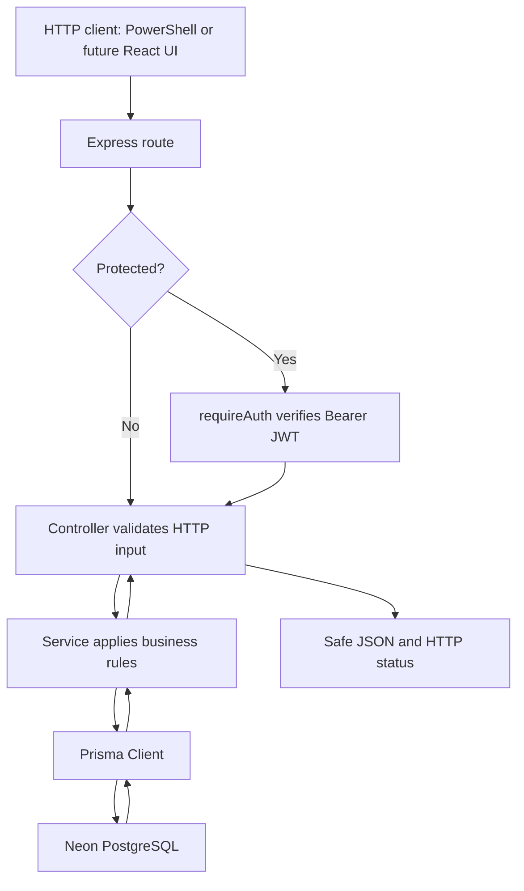

# PeerHelp

PeerHelp is a student peer-help project being built in small stages. Students can register, select subjects, post questions, and answer other students' questions. Anyone can read questions and answers; posting requires login.

The backend implements authentication, subjects, questions, and answers. The React client currently displays a placeholder screen and does not call the API. Invitations, tutoring sessions, ratings, notifications, and real-time communication are planned, not implemented.

## Technology

| Layer | Technology | Purpose |
| --- | --- | --- |
| Client | React, TypeScript, Vite | Frontend scaffold |
| API | Node.js, Express, TypeScript | Routing, validation, business logic |
| Database access | Prisma 7, PostgreSQL driver adapter | Typed queries, relations, migrations, seed |
| Database | PostgreSQL hosted on Neon | Persistent data |
| Passwords | bcrypt | One-way password hashing |
| Authentication | jsonwebtoken | Signed Bearer JWTs |

## Structure

```text
PeerHelp/
├── client/
│   ├── src/App.tsx                 # Placeholder UI
│   ├── src/main.tsx                # React entry point
│   ├── vite.config.ts
│   └── package.json
└── server/
    ├── .env.example               # Safe placeholders
    ├── prisma7.config.ts          # Prisma CLI config and seed command
    ├── prisma/
    │   ├── schema.prisma          # Models, relations, indexes
    │   ├── migrations/            # Versioned SQL changes
    │   └── seed.ts                # Initial subject catalog
    ├── src/
    │   ├── server.ts              # Load environment and start listening
    │   ├── app.ts                 # Register Express middleware/routers
    │   ├── routes/                # Methods, URLs, auth middleware
    │   ├── controllers/           # HTTP validation and responses
    │   ├── services/              # Business rules and Prisma operations
    │   ├── middleware/            # JWT verification
    │   ├── config/jwt.ts          # JWT signing/verification settings
    │   ├── lib/prisma.ts          # Shared Prisma Client with pg adapter
    │   ├── types/express.d.ts     # request.auth type
    │   └── generated/prisma/      # Generated client, ignored by Git
    ├── dist/                      # Compiled JavaScript, ignored by Git
    └── package.json
```

## Architecture



Routes match methods/URLs and select middleware. Controllers validate body/URL values and choose HTTP responses. Services check database facts and perform queries/writes. Prisma translates those operations into database access; PostgreSQL constraints protect relationships.

TypeScript checks source types during compilation. Real HTTP requests still require runtime validation. ES module source imports use `.js` extensions so they resolve after TypeScript compilation.

### Signup and login flow

1. Signup validates name, email, password (at least 8 characters), year (integer 1–4), and optional positive-integer subject IDs. Duplicate subject IDs are removed.
2. Email is trimmed/lowercased; an existing email returns `409`.
3. bcrypt hashes the password with cost factor 12. A nested Prisma write atomically creates User and UserSubject rows; failed subject assignment rolls back user creation.
4. Login finds the normalized email and calls `bcrypt.compare()`. Unknown email and wrong password share the same generic `401` message.
5. Login signs an HS256 JWT with `JWT_SECRET`, identity `{ userId }`, and a one-day expiry. The token also contains standard issue/expiry timestamps.
6. Protected routes verify the signature, expiration, allowed algorithm, and user ID. Middleware stores the identity in `request.auth.userId` before calling the controller.

Password hashes are never returned. JWT payloads are signed, not encrypted, and must not contain secrets. Refresh tokens, password recovery, email verification, and server-side logout/revocation are not implemented.

### Question and answer flow

```text
Question POST: body.text + body.subjectId + verified JWT userId
Answer POST:   body.text + URL questionId + verified JWT userId
```

Controllers trim text and reject blank/non-string values. Services verify referenced subjects/questions and users before writing. Authorship always comes from the verified JWT; a body `authorId` is ignored. Foreign-key failures during concurrent changes are handled with safe relation errors.

Public question lists are newest first. Answers are oldest first, with ID as a tie-breaker. The single-question endpoint uses `findUnique()` and `_count.answers`, returning that count as `answerCount` without fetching every answer.

## Database

| Model | Fields and relationships |
| --- | --- |
| User | Auto ID, name, unique email, passwordHash, year, isOnline, createdAt, updatedAt; many questions/answers/subject assignments |
| Subject | Auto ID, unique name, createdAt; many assignments/questions |
| UserSubject | Composite primary key `(userId, subjectId)`; foreign keys to User/Subject, both with delete cascade |
| Question | Auto ID, text, authorId, subjectId, createdAt; referenced User/Subject deletion restricted |
| Answer | Auto ID, text, authorId, questionId, createdAt, updatedAt; author deletion restricted; question deletion cascades to answers |

UserSubject provides the many-to-many User–Subject relationship. Prisma relation arrays such as `User.answers` do not become PostgreSQL array columns. `isOnline` defaults to false; presence tracking is not implemented.

Question indexes: `authorId`, `(subjectId, createdAt)`, `createdAt`. Answer indexes: `authorId`, `(questionId, createdAt)`. Indexes support lookups/ordering; they do not automatically provide API filtering or pagination.

Migration history:

```text
20260904120841_init_user_subject_schema
20260921173257_add_question
20261017110723_add_answer
```

The actual database is online, not a local database file. `schema.prisma` describes the models, migration SQL changes PostgreSQL, and `prisma generate` updates the typed query client.

## Setup: Windows PowerShell

Install Node.js compatible with the locked dependencies and npm. Development has used Node.js 22.18.0. Install dependencies separately in `server` and `client`; there is no root npm script.

### Backend environment

From the repository root:

```powershell
cd server
npm.cmd ci
if (-not (Test-Path .env)) { Copy-Item .env.example .env }
```

Edit `server/.env` manually:

| Variable | Purpose |
| --- | --- |
| PORT | API port, defaults to 5000 |
| DATABASE_URL | Your hosted PostgreSQL URL with provider-required SSL settings |
| JWT_SECRET | Your own strong private signing secret |

The example file contains placeholders. `.env` is ignored by Git; never print or commit credentials/tokens. Prisma CLI configuration lives in `prisma7.config.ts`; runtime Prisma reads the environment in `src/lib/prisma.ts`. Do not move the database URL into `schema.prisma`.

### Prisma setup

From `server`, explicitly select this repository's config filename:

```powershell
npx.cmd prisma validate --config prisma7.config.ts
npx.cmd prisma generate --config prisma7.config.ts
```

For a new development database, apply existing migrations and seed subjects:

```powershell
npx.cmd prisma migrate deploy --config prisma7.config.ts
npx.cmd prisma db seed --config prisma7.config.ts
npx.cmd prisma migrate status --config prisma7.config.ts
```

Run database commands only against a database you intend to configure. The seed uses `createMany` with `skipDuplicates` and the unique subject name constraint. Rerunning it inserts missing names without duplicating existing names or overwriting subjects.

Initial catalog:

- Data Structures and Algorithms
- Database Management Systems
- Computer Networks
- Operating Systems

Subject IDs are generated and may differ between databases. Fetch `/api/subjects` rather than guessing IDs.

For an intentional model change during development:

```powershell
npx.cmd prisma format --config prisma7.config.ts
npx.cmd prisma validate --config prisma7.config.ts
npx.cmd prisma migrate dev --name descriptive_change_name --config prisma7.config.ts
npx.cmd prisma generate --config prisma7.config.ts
npm.cmd run build
```

Inspect generated SQL and commit it with the schema. Do not casually alter applied migration history, reset shared data, or use `db push` as a replacement for migrations. Querying existing models needs no new migration.

### Start the backend

```powershell
npm.cmd run dev
```

The API listens on `http://localhost:5000` unless PORT is changed. The watcher keeps running; use a second terminal for requests and Ctrl+C to stop it.

```powershell
Invoke-RestMethod http://localhost:5000/api/health
```

Health confirms the HTTP app is running; it does not query PostgreSQL.

Compile and run the built server:

```powershell
npm.cmd run build
npm.cmd start
```

Build checks types and writes JavaScript to `dist`. It does not start the server, apply migrations, or prove connectivity. Generate Prisma Client before building a fresh checkout.

### Start the client scaffold

In a separate terminal, from the repository root:

```powershell
cd client
npm.cmd ci
npm.cmd run dev
```

Vite prints its URL, usually `http://localhost:5173`. The current UI only displays the project title/description.

## API reference

Base URL: `http://localhost:5000/api`. POST requests use `Content-Type: application/json`. Protected requests require `Authorization: Bearer <token>`.

| Method | Path | Access | Success |
| --- | --- | --- | --- |
| GET | /health | Public | 200, success/message |
| POST | /auth/signup | Public | 201, safe user |
| POST | /auth/login | Public | 200, token and safe user |
| GET | /auth/me | JWT | 200, current safe user |
| GET | /subjects | Public | 200, subjects sorted by name then ID |
| GET | /questions | Public | 200, newest questions first |
| GET | /questions/:questionId | Public | 200, question with answerCount |
| POST | /questions | JWT | 201, created question |
| GET | /questions/:questionId/answers | Public | 200, oldest answers first |
| POST | /questions/:questionId/answers | JWT | 201, created answer |

### Request bodies

Signup (`subjectIds` is optional; choose IDs from `/subjects`):

```json
{
  "name": "Example Student",
  "email": "student@example.com",
  "password": "development-example-only",
  "year": 2,
  "subjectIds": []
}
```

Login:

```json
{
  "email": "student@example.com",
  "password": "development-example-only"
}
```

Post question (replace illustrative subject ID with an existing ID):

```json
{
  "text": "What is the difference between TCP and UDP?",
  "subjectId": 1
}
```

Post answer to `/questions/<existing-id>/answers`:

```json
{
  "text": "TCP provides an ordered reliable byte stream; UDP sends independent datagrams."
}
```

### Response example

Single-question response (illustrative IDs):

```json
{
  "success": true,
  "question": {
    "id": 12,
    "text": "What is the difference between TCP and UDP?",
    "createdAt": "2026-10-24T12:00:00.000Z",
    "author": { "id": 8, "name": "Example Student" },
    "subject": { "id": 1, "name": "Computer Networks" },
    "answerCount": 0
  }
}
```

Question/answer author selections expose ID/name only. Safe account responses include the account email and subject IDs. Answers contain ID, text, createdAt, updatedAt, and safe author. No API returns passwordHash.

### Validation and errors

Handled application errors use `{ "success": false, "message": "..." }`. Express parser/default errors are not yet standardized by custom global middleware.

| Status | Meaning in current API |
| --- | --- |
| 400 | Invalid body/ID, blank text, unavailable subject/relation |
| 401 | Missing/invalid/expired token, invalid credentials, unavailable posting account |
| 404 | Missing question; `/auth/me` also uses this for a missing account |
| 409 | Duplicate signup email |
| 500 | Unexpected failure with a generic controller message |

The single-question endpoint accepts positive decimal IDs within PostgreSQL's signed 32-bit integer range. Existing Answer endpoints check positive safe integers. An existing question with no answers returns `200` with `answers: []`; a missing question returns `404`.

## Checks and manual testing

Backend, from `server`:

```powershell
npm.cmd run build
```

Frontend, from `client`:

```powershell
npm.cmd run build
npm.cmd run lint
```

No backend lint command or automated test suite is currently configured. Builds check compilation, not all runtime behavior. Verify successful requests, malformed IDs/bodies, absent records, missing/expired/invalid tokens, safe responses, and forged author IDs using isolated test data.

Example public request:

```powershell
$questions = Invoke-RestMethod http://localhost:5000/api/questions
$questions | ConvertTo-Json -Depth 10
```

Use an actual returned ID for `/api/questions/<id>`. Obtain a fresh login token for protected requests and keep it private. PowerShell displays non-2xx responses as errors; inspect the HTTP status/message. Terminal variables such as `$token`, `$headers`, and `$questionId` disappear when the terminal closes. An empty ID creates `/questions//answers`, which matches no route.

Review before committing:

```powershell
git status --short
git diff
git diff --check
```

Commit intended source/documentation/migration files. Dependencies, private environment files, generated Prisma Client, and build outputs are ignored.

## Remaining work

- Backend: subject filters, pagination, ownership-based edits/deletes, automated API tests.
- Frontend: routing, signup/login, authentication state, question feed/details, posting forms, loading/error/empty states.
- Deployment readiness: restricted CORS origins (currently unrestricted), rate limits, startup environment validation, consistent error middleware, logging, graceful shutdown, browser token-storage/expiry decisions, deployment configuration.
- Broader tutoring features: invitations, sessions, presence, Socket.IO communication, notifications, ratings.

These are roadmap items, not current functionality. The current repository is not a complete production tutoring platform.

